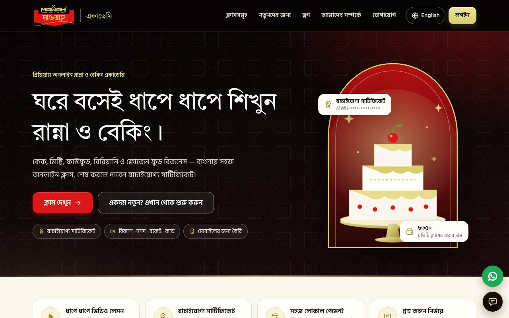

# MAWAH Academy · মাওয়াহ একাডেমি

**A premium, bilingual (Bangla + English) online cooking & baking class platform** — fast public site, a student learning app, and a full admin dashboard for a non-technical team. Built on **Cloudflare Workers (Hono + TypeScript), D1, KV, R2 and Stream**, deployed from GitHub Actions.



| | |
|---|---|
| **Public site** | Server-rendered, edge-cached, ≈ 4 KB of JavaScript. The 26 launch classes with the owner’s prices, class pages with structured data, blog, certificate verification. Lighthouse (mobile): accessibility / best practices / SEO **100**, performance **91–99** |
| **Student app** (`/app`) | Register, buy (SSLCommerz · bKash · Nagad · Rocket · cards · manual send-money (20-minute pay window, TrxID and/or screenshot, ready-made WhatsApp message) · free), watch lessons (Stream video with signed tokens), track progress, ask questions, review (enrolled students only), earn **verifiable certificates**, invoices |
| **Admin** (`/admin`) | Health check and “needs attention today” first, then classes + curriculum builder, orders (verify / refund), students, reviews, Q&A, coupons, bundles, certificates, Coming-Soon notify lists, reports, team with **roles**, audit log, AI chatbot settings — CSV export everywhere |
| **AI chatbot** | Workers AI by default, Gemini switchable in the admin (no code change), grounded in your live catalogue, honest “I’m not sure” with hand-off to the team |
| **Security** | PBKDF2 + pepper, opaque sessions, strict CSP (no `unsafe-inline`), CSRF guard, RBAC on every route, rate limits, signed video and authenticated file access, audit log, webhook-driven idempotent payments — see [docs/security.md](docs/security.md) |
| **Honesty guardrail** | No fabricated “X enrolled / Y watching” counters anywhere; ratings only from real reviews by enrolled students |

📘 **Start here:** [the A–Z specification](docs/spec.md) · [deployment guide](docs/deployment.md) · [owner guide (বাংলা + English)](docs/owner-guide.md) · [security](docs/security.md) · [decisions to confirm](docs/decisions.md)

---

## Quick start (no Cloudflare account needed)

```bash
git clone https://github.com/bayzed123/academy.mawahbd.com
cd academy.mawahbd.com
npm ci
npm run dev
```

Open **http://localhost:8787** (Bangla) · **/en** (English) · **/app/** (student) · **/admin/** (create the first admin with the setup token from `worker/.dev.vars`, `dev-setup-token`). At checkout pick **“Test payment”** — a simulated gateway that exists only locally. The first run loads demo lessons, a free class and the coupon `WELCOME10`; `npm run dev -- --reset` starts clean.

Requires **Node.js ≥ 20.19** (22 recommended). Local D1/KV/R2 run on your machine through Wrangler; Stream and Workers AI exist only on a real Cloudflare account, so locally video lessons show a notice and the chatbot hands off.

## Commands

| Command | What it does |
|---|---|
| `npm run dev` | Everything for local work: builds, migrates a local database, runs the Worker (8787) and hot-reload servers for the student app (5173) and admin (5174) |
| `npm run typecheck` | `tsc` in all four workspaces (required before any deploy) |
| `npm test` | i18n completeness, script tests, and **156 Vitest tests inside the real Workers runtime** (routes, money, security, admin, contracts, plus guards enumerated from the router and production-mode hardening) and **palette/brand checks** (contrast ratios, logo and icon files) |
| `npm run build && npm run test:e2e` | **35 Playwright tests** against a real Worker on a fresh seeded database: enrol → pay → learn → certificate, the admin workflows, accessibility (axe), 360 px phones |
| `npm run lighthouse:local` | Core Web Vitals gate on the public pages (mobile profile) |
| `npm run setup:cloudflare -- --secrets` | Only for deploying from your own computer: creates D1/KV/R2, fills `wrangler.toml`, sets the secrets (`--dry-run` first). **GitHub’s Deploy workflow does all of this by itself** — see [deployment.md](docs/deployment.md) |
| `npm run db:migrate:remote` · `npm run deploy` | Apply migrations / build and deploy (normally done by GitHub Actions on every push to `main`) |
| `npm run check:i18n` · `npm run brand:assets` | Bangla/English dictionary check · rebuild every logo, icon and social-share file from `brand/mawah-logo.jpg` |

## Project layout

```
worker/      Cloudflare Worker: public pages (Hono + JSX), JSON API, payments, chatbot, cron, D1 migrations, tests
brand/       the owner’s original logo (source of the generated logo/icon files)
marketing/   public-site CSS/JS, chat widget, fonts, sprite, logo, icons, social image
app/         React student app          admin/   React admin CMS          shared/  types, RBAC table, i18n, design tokens
e2e/         Playwright specs           tests/   API fixtures + test guide  scripts/ dev runner, setup, builds, Lighthouse gate
docs/        specification and guides   .github/ CI, deploy and Lighthouse workflows
```

The full annotated tree is in [docs/spec.md §13](docs/spec.md#13-file-and-folder-structure).

## Deploying

Push to `main` → GitHub Actions runs every check → looks at the Cloudflare access and the domain → applies D1 migrations → `wrangler deploy` (which also attaches the custom domain) → health check → checks the public address the way a visitor and a search engine meet it → Lighthouse on the live pages. The site lives at **https://mawahacademy.com** (`www.` sends visitors on to it); the free `workers.dev` address stays as a fallback. One-time setup (Cloudflare resources, repository secrets, domain, first admin, payment sandbox checklist) is in **[docs/deployment.md](docs/deployment.md)**. Secrets are Wrangler secrets — **never** committed; a secret scanner runs on every pull request and every release.

## Choices made for you (please confirm — [docs/decisions.md](docs/decisions.md))

* **Single brand**, instructors added by the owner (a multi-instructor marketplace is roadmap Phase 4).
* **Local payments first** (SSLCommerz / bKash / manual); international cards via Stripe are Phase 3.

## Honest limits — what is *not* done or *not verified*

* **Payment gateways were never exercised against the real services.** The SSLCommerz and direct-bKash adapters are covered by tests with simulated responses; the whole chain is proven end-to-end with the built-in test gateway and manual send-money. Do the [sandbox checklist](docs/deployment.md#payment-go-live-checklist) before launch. Nagad is available *through* SSLCommerz (no separate direct integration).
* **Nothing was deployed or tested on a real Cloudflare account**, and the GitHub workflows have not yet run on GitHub — the first pull-request run is their first real test. Stream and Workers AI are reached through bindings that exist only on Cloudflare; their code paths are tested with mocks.
* **PDF**: invoices and certificates are print-styled pages; *Print / Save as PDF* in the browser produces the PDF (this shapes Bangla correctly). A server-generated PDF is on the roadmap.
* **Not built yet:** Stripe, SMS, referral/loyalty, quizzes, PWA/offline lessons, Google sign-in, two-factor authentication, self-service account deletion, Meta Conversions API.
* **Content:** the 26 classes are published **without lessons** (the dashboard flags them); instructor, policies and contact details are placeholders for the owner to fill in.

## Contributing

Work on a branch, open a pull request (the template lists the checks), and let CI pass. Database changes are **new** numbered files in `worker/migrations/`. Never commit a key, a `.dev.vars` file or real customer data.

---

*MAWAH Academy — মাওয়াহ একাডেমি. All rights reserved by the owner.*
