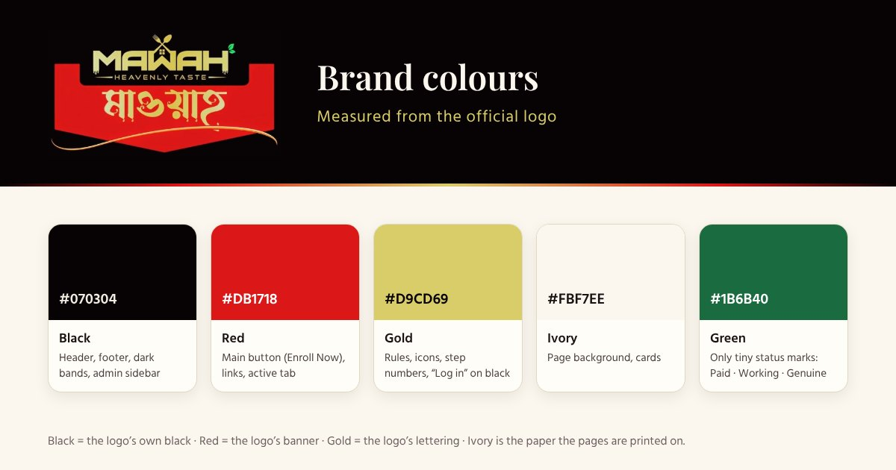
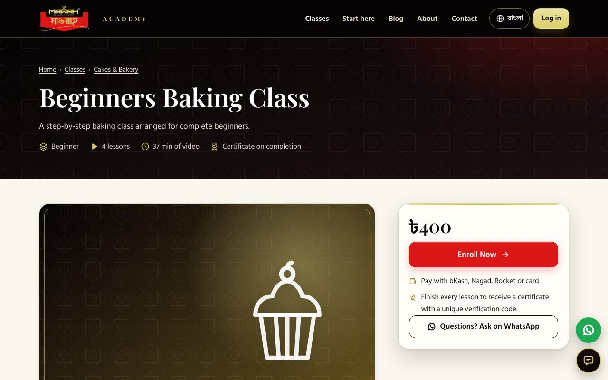
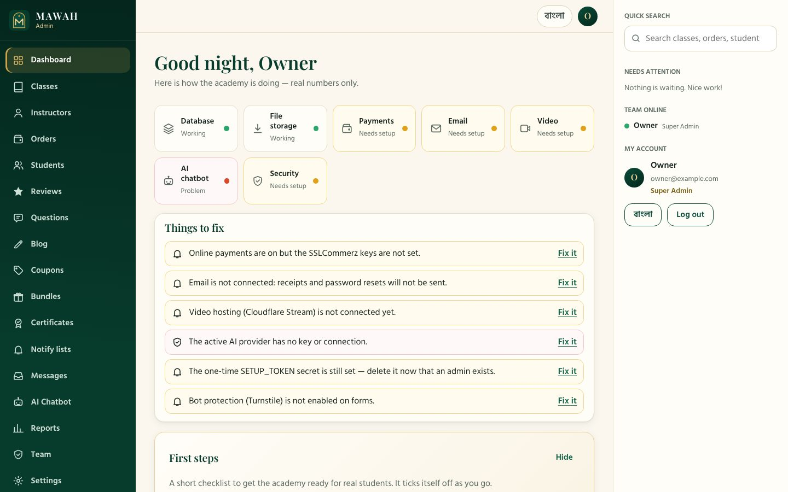
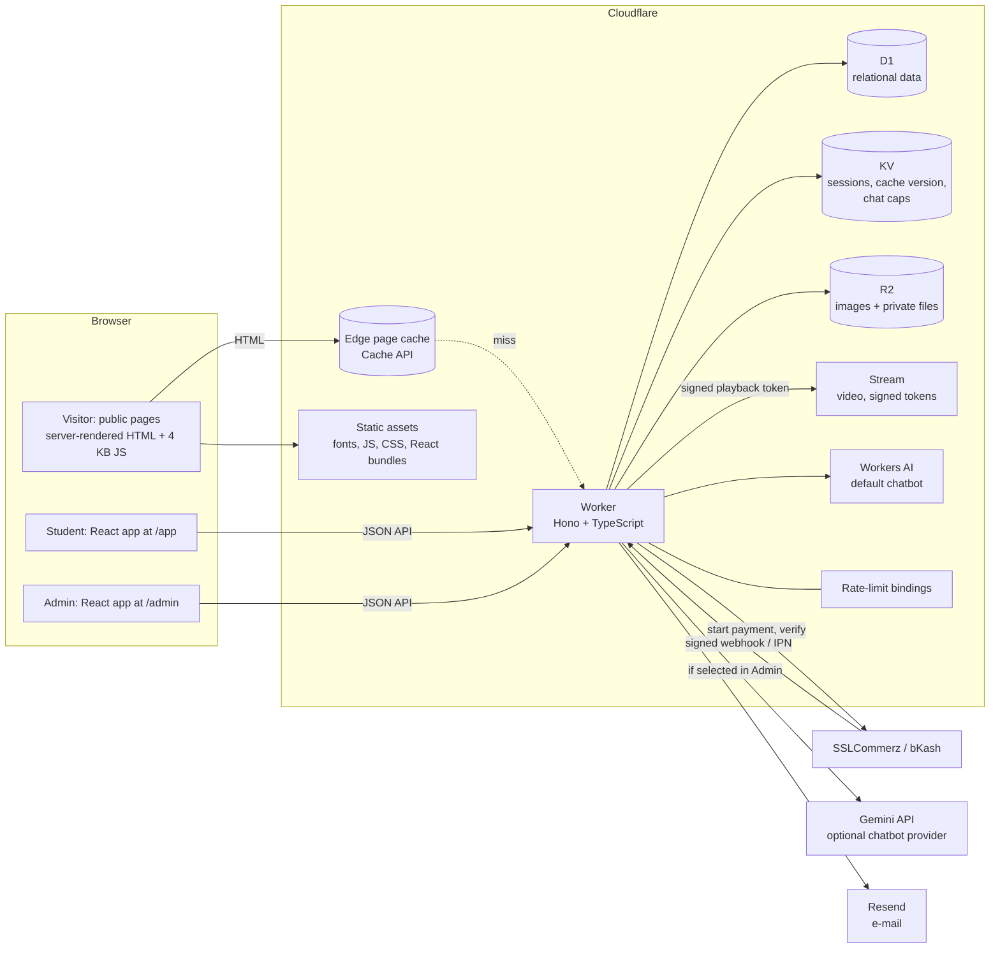
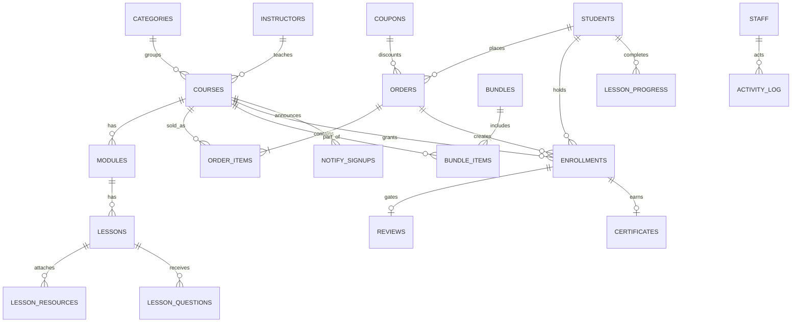
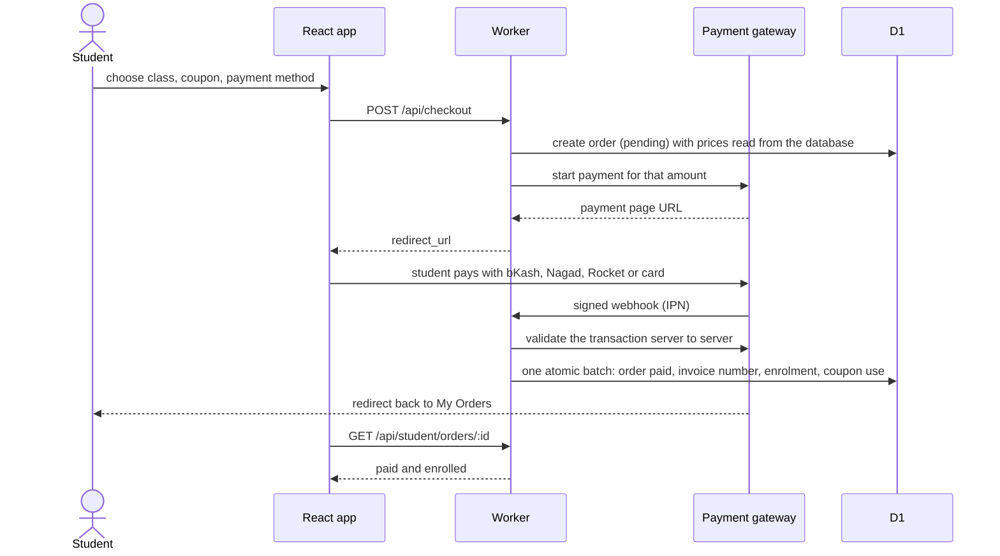
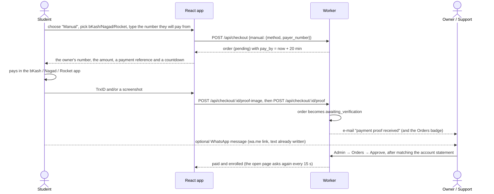
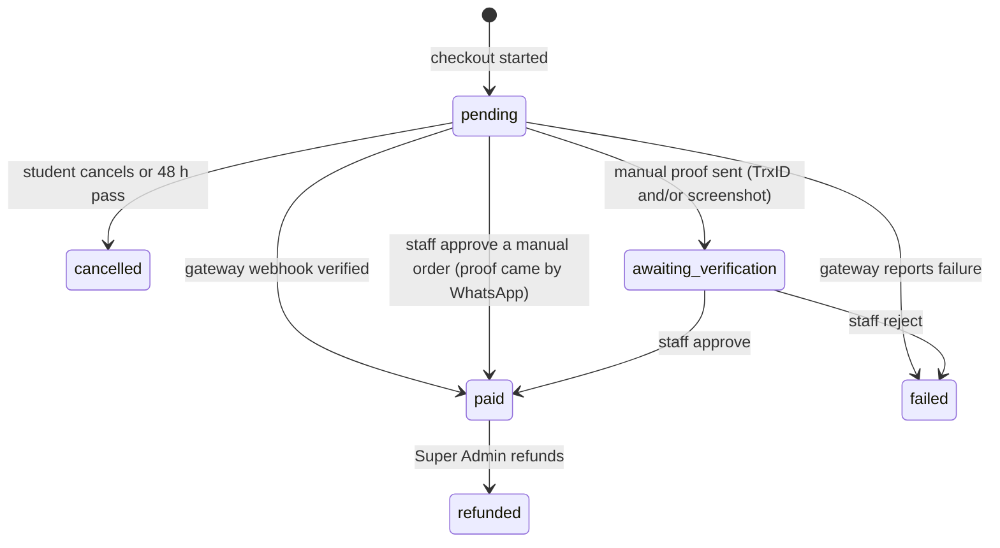
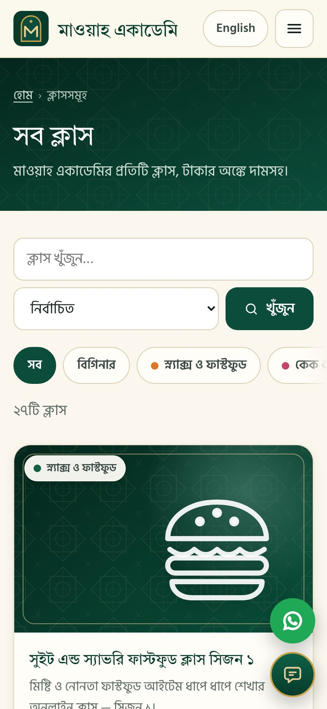

# MAWAH Academy — the A–Z specification (as built)

> **What this is.** The single structured document for the platform: sections follow the numbering of the original brief (1–21), with the architecture diagram, a table for every data model, TypeScript/JSON snippets, the folder tree and a glossary of the Bangla UI terms.
> It describes **what exists in this repository today**, how it was verified, and — where something is not done yet — says so plainly.
>
> Legend: ✅ built and covered by automated tests · 🟡 built, but needs your live credentials/account to verify (nothing here could be tried against a real payment gateway or Cloudflare account) · ⏭ not built yet (roadmap).
>
> Deeper guides: [deployment](deployment.md) · [security](security.md) · [owner guide (বাংলা + English)](owner-guide.md) · [decisions to confirm](decisions.md)


## Contents

1. [Brand, purpose and business requirements](#1-brand-purpose-and-business-requirements)
2. [Public website — design and class discovery](#2-public-website--design-and-class-discovery)
3. [Student experience](#3-student-experience)
4. [Admin dashboard](#4-admin-dashboard)
5. [AI support chatbot](#5-ai-support-chatbot)
6. [Full-stack architecture](#6-full-stack-architecture)
7. [Data models](#7-data-models)
8. [Payments and enrolment flow](#8-payments-and-enrolment-flow)
9. [Security and compliance](#9-security-and-compliance)
10. [Performance and speed](#10-performance-and-speed)
11. [Testing strategy](#11-testing-strategy)
12. [Dashboard development plan](#12-dashboard-development-plan)
13. [File and folder structure](#13-file-and-folder-structure)
14. [Development environment and deployment](#14-development-environment-and-deployment)
15. [SEO, marketing and analytics](#15-seo-marketing-and-analytics)
16. [Class categories and content plan](#16-class-categories-and-content-plan)
17. [Phased roadmap](#17-phased-roadmap)
18. [Development and delivery conventions](#18-development-and-delivery-conventions)
19. [Additional premium features](#19-additional-premium-features)
20. [Owner-friendly operations and onboarding](#20-owner-friendly-operations-and-onboarding)
21. [Acceptance checklist](#21-acceptance-checklist)
22. [Glossary of Bangla UI terms](#22-glossary-of-bangla-ui-terms)

---

## 1. Brand, purpose and business requirements

| | |
|---|---|
| **Brand** | MAWAH Academy · মাওয়াহ একাডেমি · short code `MWH` (invoice prefix) · `mawahacademy.com` |
| **Business** | Online **cooking and baking** classes: class sales, the student learning experience, verifiable certificates |
| **Market** | Bangladesh first (mobile-first, Bangla + English, BDT prices, local payments), with a path to international payments later |
| **Tagline** | EN *“Learn cooking & baking step by step, from home.”* · BN *“ঘরে বসেই ধাপে ধাপে শিখুন রান্না ও বেকিং।”* |
| **Positioning** | A *prestige academy*, not a template shop: black, red and gold like the logo, calm ivory reading pages generous with whitespace, ornament kept to thin gold rules (with a small red accent) and a faint lattice |

**Logo and colours.** The site uses the owner’s **official logo** — gold “MAWAH · HEAVENLY TASTE” lettering with a house-and-cutlery mark on black, over a red banner carrying the Bangla name. The original file is kept as `brand/mawah-logo.jpg`; `npm run brand:assets` (`scripts/gen-brand-assets.mjs` + `scripts/gen-og-image.mjs`) crops it and writes every derived file in `marketing/public/` — the header/footer logo, the favicon and app icons, the manifest’s icons and the social-share image. Dark pixels are lifted to the exact brand black, so the logo melts into the black header and footer with no visible box. The whole palette is **measured from the logo** (warm black, brand red, champagne gold) with ivory paper for reading; the tiny green of the logo’s leaf is used only for “paid / working / genuine” status markers.

**Design language** (one source of truth: `shared/styles/base.css`, shared by the public site, the student app and the admin)



| Token | Value | Use |
|---|---|---|
| Black | `#070304` (the logo’s own black, `--k-950`) → `#2c1b1d` | Header, footer, dark bands, the admin sidebar, hero |
| Red | `#db1718` (the logo’s banner, `--red-600`); hover `#b50f12` | The main call to action (“Enroll Now”), links, the active tab, progress bars |
| Gold | `#d9cd69` (the logo’s lettering, `--g-400`); text on ivory uses the darker `#665613` for WCAG AA contrast | Rules under headings, step numbers, icons, the header “Log in” button, highlights on dark |
| Ivory | `#fbf7ee` / `#f4eddc` | Page background |
| Success green | `#1b6b40` on `#ecf8f1` | Status markers only: Paid, Working, “This certificate is genuine”, discounts |
| Category accents | snack red · cake gold `#9a8627` · dessert deep red `#8c0b0e` · cook charcoal `#43292c` · sweet dark gold `#816f1c` · frozen warm grey `#6d5f60` | A dot/tag on cards and the tint of a class banner — kept inside the brand palette (wayfinding, not a re-theme) |
| Contrast | every text/background pair of the palette ≥ 4.5:1 (icons ≥ 3:1) | Checked by `scripts/lib/brand.test.mjs`, so a future colour tweak cannot quietly make the site hard to read |
| Type | **Playfair Display** (English display) · **Tiro Bangla** (Bangla display) · **Hind Siliguri** (body, Bangla + Latin) | Self-hosted WOFF2 under the SIL Open Font License (`marketing/public/fonts/LICENSE-*.txt`); Bangla text is never letter-spaced (it breaks conjuncts) |
| Touch | ≥ 44–48 px targets, plain-language labels | The team and most students are non-technical, on phones |

**Decisions made (and why)** — the brief asks to fix these *before* building; they are repeated in [decisions.md](decisions.md) so you can overrule them:

* **Single brand, admin-onboarded instructors.** There is one academy and one catalogue. Instructors are profiles the *owner* adds (`instructors` table, Admin → Instructors); there are no self-serve teacher accounts. A marketplace where outside teachers sell their own classes is a different build — kept as roadmap Phase 4.
* **Local payments now, Stripe later.** SSLCommerz (bKash/Nagad/Rocket/cards), optional direct bKash, and manual send-money are built. International cards via Stripe are roadmap Phase 3, to be added if the audience turns out to be partly abroad.

**Bilingual everywhere.** Every customer-facing and admin string exists in Bangla *and* English (≈ 1,040 keys per language: `shared/src/i18n/`). A language toggle is on every screen; the choice is remembered across the site, the student app and the admin. `npm run check:i18n` fails the build if a key is missing in either language, if placeholders differ, or if a run-time-built key (status words, health issues, nav labels) is missing — so the UI can never show a raw key.

---

## 2. Public website — design and class discovery

Server-rendered by the Worker (Hono + JSX), **no client framework**: each page is plain HTML with the CSS inlined (≈ 33 KB, no render-blocking request) and a ≈ 3.7 KB script for progressive enhancements. The Bangla site lives at `/`, English at `/en` (each with `hreflang` alternates).

| Route (prefix `/en` for English) | Page |
|---|---|
| `/` | Home: **the owner’s banner slider (Admin → Banners, if any) above a compact welcome**, hero, trust strip, the classes grid, a “beginners start here” row, categories, how it works, instructors, **reviews (only if real, approved ones exist)**, **a short “Questions before you join” band (the owner’s home-page questions, if any)**, latest blog posts, newsletter sign-up |
| *(every public page)* | **Footer**: classes, company (About, Blog, FAQ, Contact, Verify, Shop), policies, contact, a **“We accept” row of the real marks** (the owner’s bKash, Nagad and Rocket pictures, drawn 3× sharp by `scripts/gen-pay-logos.mjs` from `brand/pay/`, plus Visa and Mastercard as small vector files — each on a white badge, lazy-loaded, sized in the markup so nothing jumps), then “© year MAWAH Academy. All rights reserved.”, the **developer credit** (“Developed by Sayad Bayezid”, a visible link to sayadbayezid.com that opens in a new tab with `rel="noopener noreferrer"`) and the tagline |
| `/faq` | **FAQ**: every active site-wide question grouped by topic (General · Payment · Learning · Certificates · Refunds) as keyboard-friendly accordions (`<details>`, no script), topic chips, a “Still have a question?” card (WhatsApp when set, Contact) and `FAQPage` structured data for exactly the questions shown |
| `/courses` | All classes: category chips, level filter, search, sort (featured · newest · price ↑ ↓), 12 per page |
| `/courses/:slug` | Class page: banner, about (Markdown), what’s included, **curriculum titles only**, free-preview lessons, instructor with a **MAWAH Academy badge and real rating**, the **rating line, summary (average, star breakdown) and reviews** — part of the page itself, so search engines and no-script visitors get them; an empty class says “No reviews yet” and invites the first review — **what the class includes beyond lessons (a count per kind and the titles of the owner’s materials — never an address or a file)**, **the class’s own questions first, then the home-page ones**, and related classes (lazy-loaded), price box / sticky buy bar |
| `/instructors/:slug` · `/blog` · `/blog/:slug` · `/about` · `/contact` · `/policies/{refund,privacy,terms}` | Content pages, all editable in the admin |
| `/verify` · `/verify/:code` · `/certificate/:code` | Public certificate verification and the printable certificate |
| `/sitemap.xml` · `/robots.txt` | SEO |

**Class card** (`worker/src/views/ui.tsx`): banner (an uploaded picture, or a generated emblem banner from the class icon + category accent), category chip, title, short description, level · lessons · duration, then either **Read More + Enroll Now · ৳price**, or — for a *Coming Soon* class — a **Coming Soon** badge with a **notify me** form (see §19). Prices are whole BDT.

**Discovery.** The class list is indexed and paginated from day one (`idx_courses_list`, `idx_courses_category`, `idx_courses_featured`, `idx_courses_price`); search is a bounded `LIKE` over title/short/slug with escaped wildcards. Category pills become a single scrollable row on phones.

**Honest social proof.** There is no “1,234 students enrolled” or “56 watching now” anywhere. A star rating is shown only when approved reviews from enrolled students exist (`rating_count > 0`); the Course JSON-LD omits `aggregateRating` otherwise. Tests assert this.

**The launch catalogue** — 26 classes with the owner-supplied prices (generated into `worker/migrations/0002_seed_catalog.sql` by `scripts/gen-seed-catalog.mjs`; every class starts *published with no lessons* and the dashboard says so until lessons are added):

| # | Category | Class (English) | ক্লাস (বাংলা) | Price |
|---|---|---|---|---|
| 1 | Snacks & Fast Food | Sweet & Savory Fast Food Class — Season 1 | সুইট এন্ড স্যাভরি ফাস্টফুড ক্লাস সিজন ১ | ৳1,850 |
| 2 | Snacks & Fast Food | Sweet & Savory Fast Food Class — Season 2 | সুইট এন্ড স্যাভরি ফাস্টফুড ক্লাস সিজন ২ | ৳1,550 |
| 3 | Snacks & Fast Food | Puff Pastry Special Class | পাফ প্যাস্ট্রি স্পেশাল ক্লাস | ৳1,150 |
| 4 | Snacks & Fast Food | Shahi Iftar Class | শাহী ইফতার ক্লাস | ৳2,550 |
| 5 | Cakes & Bakery | Premium Signature Cake Master Class — Season 1 | প্রিমিয়াম সিগনেচার কেক মাস্টার ক্লাস সিজন ১ | ৳1,550 |
| 6 | Cakes & Bakery | Premium Signature Cake Master Class — Season 2 | প্রিমিয়াম সিগ্নেচার কেক মাস্টারক্লাস সিজন ২ | ৳1,550 |
| 7 | Cakes & Bakery | Ultimate Triple Chocolate Matilda Cake Class | আল্টিমেট ট্রিপল চকলেট মাটিলডা কেক ক্লাস | ৳850 |
| 8 | Cakes & Bakery | London Cake / Dark Chocolate Salted Caramel Brigadeiro Cake | লন্ডন কেক/ডার্ক চকলেট সল্টেড ক্যারামেল ব্রিগাডেইরো কেক | ৳850 |
| 9 | Cakes & Bakery | Muffin Special Class | মাফিন স্পেশাল ক্লাস | ৳1,050 |
| 10 | Cakes & Bakery | Beginners Baking Class | বিগিনার্স বেকিং ক্লাস | ৳400 |
| 11 | Cooking & Biryani | Beginners Basic Cooking & Dessert Class | বিগিনার্স বেসিক কুকিং এন্ড ডেজার্ট ক্লাস | ৳1,050 |
| 12 | Cakes & Bakery | Exclusive Brownie Master Class | এক্সক্লুসিভ ব্রাউনি মাস্টার ক্লাস | ৳1,850 |
| 13 | Desserts & Drinks | Exclusive Short Glass Dessert Class | এক্সক্লুসিভ শর্ট গ্লাস ডেজার্ট ক্লাস | ৳2,550 |
| 14 | Desserts & Drinks | Mango Season Special Class | ম্যাংগো সিজন স্পেশাল ক্লাস | ৳2,050 |
| 15 | Desserts & Drinks | Saffron Pistachio Sharbat & Mahalabia Class | জাফরানি পেস্তা শরবত ও মাহলাবিয়া ক্লাস | ৳610 |
| 16 | Cooking & Biryani | Tehari & Dessert Bowl Class | তেহারি ও ডেজার্ট বোল ক্লাস | ৳650 |
| 17 | Cooking & Biryani | Traditional Aurosh Biryani Online Class | ঐতিহ্যবাহী ঔরশ বিরিয়ানি অনলাইন ক্লাস | ৳350 |
| 18 | Sweets & Halua | Rasgulla Special Class | রসগোল্লা স্পেশাল ক্লাস | ৳750 |
| 19 | Sweets & Halua | Advanced Mishti Class | এডভান্স মিষ্টি ক্লাস | ৳1,250 |
| 20 | Sweets & Halua | Exclusive Mishti Short Class | এক্সক্লুসিভ মিষ্টি শর্ট ক্লাস | ৳550 |
| 21 | Sweets & Halua | Kalojam & Aflatun Mishti Special Class | কালোজাম, আফলাতুন মিষ্টি স্পেশাল ক্লাস | ৳850 |
| 22 | Sweets & Halua | Sugar-Free Mishti Class | সুগার ফ্রি মিষ্টি ক্লাস | ৳1,250 |
| 23 | Sweets & Halua | Best Halua & Borfi Class | বেস্ট হালুয়া বরফি ক্লাস | ৳1,550 |
| 24 | Sweets & Halua | Premium Mishti Master Class | প্রিমিয়াম মিষ্টি মাস্টার ক্লাস | ৳3,550 |
| 25 | Frozen Food & Business | Frozen Food Business Master Class | ফ্রোজেন ফুড বিজনেস মাস্টার ক্লাস | ৳3,500 |
| 26 | Frozen Food & Business | Kids Tiffin Special Frozen Food Class (Homefood Special) | কিডস টিফিন স্পেশাল ফ্রোজেনফুড ক্লাস (হোমফুড স্পেশাল) | ৳1,150 |

Prices total ৳36,860 for all 26 classes; the cheapest entry class is **৳350**, the most premium **৳3,550**.

---

## 3. Student experience

The logged-in experience is a React app at `/app` (code-split; the heavy parts are only fetched when used).

| Area | What the student can do |
|---|---|
| **Account** | Register (name, e-mail, mobile, password), log in, “forgot password” by e-mail link (single use, 1 h), change password (this signs out every other device), edit profile, remembered language |
| **Class materials** (on the class page, `/app/learn/:slug`) | A “Class materials” section for **enrolled students only**: cards for files to **download** (name and size), links, **live classes** (start time in Bangladesh time, Upcoming / Live now / Ended) and **private groups** (a Facebook group first asks for the student’s Facebook profile link; the group link follows). A plain notice at the top: *for your own learning only — please do not share, resell or re-upload; downloads are recorded against your account*. The list carries no address and no file key: a file comes through the download route, a link through the “open” route, both enrolment-checked and recorded |
| **My Learning** | Cards for every enrolled class with a progress bar, “Continue” (resumes at the right lesson), “Certificate ready”, and a banner for a payment that is still being verified |
| **Class player** | Curriculum with progress ticks · **video** lessons through Cloudflare Stream (a short-lived signed token minted per request, only for enrolled students) · **external** lessons (YouTube/Vimeo embeds) · **written** lessons (Markdown) · downloadable **recipe cards/files** (private storage, enrolled-only) · *Mark as complete* (undoable) · **drip** lessons that unlock on a schedule |
| **Questions** | Ask a question under any lesson; staff answer; answered questions are visible to classmates |
| **Reviews** | Only a student *with an active enrolment in that class* can review it (server-enforced, `UNIQUE(course, student)`); reviews wait for approval; nothing is public until approved |
| **Certificates** | Issued automatically at 100 % completion: code `MWH-XXXX-XXXX-XXXX` (an alphabet without look-alike letters), a printable certificate with a QR code to the public verification page; sloppy typing still verifies (`mwh 7k3m …`); staff can revoke and re-issue (the old code stops verifying) |
| **Orders** | Every order with status, invoice number and a printable invoice (A4, *Save as PDF* from the browser — see §21 for why) |
| **Free preview** | A class can mark lessons as free previews: anyone can watch them without an account, with a clear path to enrol |



---

## 4. Admin dashboard

A React app at `/admin`, three panes: **navigation** · **work area** · **right rail** (quick search, “needs attention”, who is online, your account). On phones the navigation becomes a drawer and the rail a slide-over; every screen was checked at 360 px wide and on tablet.



**Home screen order** (chart-heavy analytics come *after* what needs a human): health strip → things to fix → first steps → **needs attention today** → KPIs → charts → top classes → latest orders and enrolments. KPIs are real numbers only; money figures are hidden from roles without the revenue permission.

**Modules**: **Materials** (one visible place for everything a class gives besides lessons: a **type chooser** — video · PDF · ZIP file pack · book / e-book · live class · link · private group — then only the fields that type needs: an **upload box** with progress for a file (up to 95 MB, judged by its own bytes) or a link instead, a start time in Bangladesh time for a live class, a group link for a private group — plus a table with filters and CSV, a **Group requests** page and a **Download log**), Classes (a one-click **Active / Inactive** switch in the list that asks before hiding a class, a read-only **overview page** with real numbers, a separate **edit mode**; with a curriculum builder: modules, lessons, drag-free up/down ordering, video upload with processing status, file attachments) · Instructors · Orders (verify, reject, refund) · Students (block, grant/revoke access, reset link) · Reviews · Questions · Blog · Coupons · Bundles · Certificates (revoke/re-issue) · Notify lists · Messages and chatbot hand-offs · AI Chatbot · Reports (revenue, learning) · Team · Settings · Activity log · Help & guide.

**Every list** has server-side search, filters, sort and pagination kept in the URL (so it can be bookmarked/shared), **CSV export** (UTF-8 with BOM for Excel, formula-injection neutralised), soft delete with restore, and consistent loading / empty / error states.

**Role-based access** — one table (`shared/src/constants.ts`) read by *both* the Worker (it enforces it on every route) and the admin UI (it hides what a role cannot do):

| Permission | Super Admin | Content Manager | Support | Viewer |
|---|:-:|:-:|:-:|:-:|
| View dashboard, classes, **materials**, instructors, blog, coupons, bundles, banners, **FAQ**, reviews, questions, certificates, notify lists, messages, settings | ✅ | ✅ | ✅ | ✅ |
| Create / edit / delete / publish classes, **materials** (and answer group requests), instructors, blog, bundles, **banners**, **FAQ**, coupons; upload media | ✅ | ✅ | — | — |
| View orders and students | ✅ | — | ✅ | ✅ |
| Approve / reject manual payments; block students; grant access; moderate reviews; revoke certificates | ✅ | — | ✅ | — |
| Answer lesson questions; handle notify lists and messages | ✅ | ✅ | ✅ | — |
| **Refund** an order | ✅ | — | — | — |
| Revenue report, activity log | ✅ | — | — | ✅ |
| Learning report | ✅ | ✅ | ✅ | ✅ |
| AI chatbot screen (read) | ✅ | ✅ | — | ✅ |
| Change chatbot, settings, **team** | ✅ | — | — | — |

---

## 5. AI support chatbot

* **Providers.** *Cloudflare Workers AI* is the default (no key needed: it is a binding); *Google Gemini* is a drop-in alternative. The owner switches in **Admin → AI Chatbot** — no code change, no redeploy. Both are behind one interface (`worker/src/lib/ai-providers/`).
* **Keys.** The owner can paste a Gemini key into the admin screen: it is encrypted with AES-GCM (key derived from the Worker secret with HKDF), **never returned by any API**, and shown only as “ends with ••••1234”. A `GEMINI_API_KEY` Wrangler secret works too. **Test connection** performs a real round trip and reports the honest result (including “failed”).
* **Grounded answers.** The system prompt is built per request from the *live* catalogue (published and coming-soon classes, prices, levels), the owner’s policies and FAQ, and — if asked from a class page — that class. The model is told to say **“I’m not sure”** instead of guessing; it then appends a hand-off marker, which is stripped from what the visitor sees and stored as a **chat hand-off** for the team (Admin → Messages). The reply also offers WhatsApp.
* **Cost and abuse control.** 12 messages/min per client (rate-limit binding), 80/day per IP and 4,000/day site-wide (KV counters), bounded input length, history trimmed. If the provider is down the visitor gets a friendly message and a hand-off, never an error page.
* **Widget.** A floating button on the public site and the student app; the 6.5 KB script is fetched only when someone opens it.

---

## 6. Full-stack architecture



**Why hybrid.** The pages a cold visitor lands on (home, class list, class detail, blog, instructor) decide both SEO and first-impression conversion, so they are rendered by the Worker as lean HTML and cached at the edge. The logged-in app and the admin are React (Vite): richer interactivity is worth the extra JavaScript *because the user is already committed* — and it never leaks into the browsing experience.

**One Worker serves everything** (`worker/src/app.tsx`):

| Path | Served by |
|---|---|
| `/`, `/en/*` | Public pages (HTML, edge-cached) |
| `/_f/*` | Small HTML fragments fetched lazily: related classes (and the old reviews fragment, kept so a page cached before the release can still fill its reviews) |
| `/app/*`, `/admin/*` | The React shells (`index.html` + the hashed bundles from Cloudflare’s asset layer; the Worker adds CSP and the SPA fallback) |
| `/api/*` | JSON API (`auth`, `student`, `checkout`, `payments`, `chat`, `admin/*`, public reads) |
| `/media/*` | Public images from R2 (immutable cache; only image types; SVG refused) |
| `/fonts/*`, `/assets/*`, `/sprite.svg` … | Static assets, served straight from Cloudflare’s asset layer with long-lived cache headers (no Worker run) |

**Edge page cache.** Public pages are identical for every visitor, so each is rendered once per data centre and served from the Cache API. The cache key is *path + the few query parameters that change the page + a “content version”* kept in KV; **any admin edit bumps the version**, which invalidates every cached page — immediately in the data centre that handled the edit and within about a minute everywhere else (KV is eventually consistent). Marketing parameters (`?fbclid`, `?utm_*`) never fragment the cache. Cached HTML is anonymous; a non-secret cookie flag lets the script swap “Log in” for “My Learning”.

**One public address.** The site lives at `SITE_URL` (`https://mawahacademy.com`); Cloudflare attaches that name and `www.` to the Worker as custom domains (it creates their DNS records and certificates). In production the Worker sends plain http to https and `www.` to the main name with permanent redirects that keep path and query, and answers on any other address — the free `workers.dev` one, used for the checks right after a deploy — with `X-Robots-Tag: noindex` and a `robots.txt` that closes the door, so search engines only ever list the real address. Canonical links, `hreflang`, the sitemap, e-mail links and payment callbacks are all built from `SITE_URL`. Sign-in cookies are `__Host-` cookies, so they belong to one address.

**Storage.** D1 = relational data · KV = sessions (only a SHA-256 of the token is stored), content version, chat/day counters, dev mail outbox · R2 = public images (`banners/ photos/ blog/`, content-hash names), **private** lesson files (`resources/`) and **private class materials** (`materials/`) — both downloaded only through an authenticated, enrolment-checked route and **private payment screenshots** (`proofs/`, opened only by staff who may verify payments) · Stream = video.

**Scheduled work** (cron, every 6 h; every step independent and idempotent): cancel checkouts abandoned for 48 h (an unpaid manual order too — one waiting for staff is never auto-closed) · delete payment screenshots 90 days after their order was settled · purge used/expired tokens · drop old unverified payment events · finish interrupted launch e-mails.

**Delivery path**

```mermaid
flowchart LR
  DEV["Developer"] -->|"pull request"| GH["GitHub"]
  GH --> CI["CI: typecheck, unit tests, E2E, Lighthouse, secret scan"]
  CI -->|"green, merged to main"| DEP["Deploy workflow"]
  DEP --> PRE["Access check (token, R2, the domain's zone) + find or create D1 / KV / R2"]
  PRE --> MIG["D1 migrations apply --remote"]
  MIG --> WD["wrangler deploy"]
  WD --> CF["Cloudflare: Worker + static assets"]
  CF --> SEC["Secrets (APP_SECRET, SETUP_TOKEN) if missing"]
  SEC --> HC["Health check of the free address: /api/health"]
  HC --> PUB["Public address check: pages, canonical links, robots.txt, sitemap, https + www redirects"]
  PUB --> LH["Lighthouse on the live pages"]
```



---

## 7. Data models

Conventions: integer ids · money in **whole BDT** (integers) · UTC ISO-8601 timestamps · soft delete (`deleted_at`) where content must be recoverable · constraints (`CHECK`, `UNIQUE`, partial indexes) express the business rules so they hold even if application code is wrong. The full DDL is `worker/migrations/0001_init.sql`; the seed is `0002`; `0003` adds the encrypted-key column.



### Catalogue

| Table | Key columns | Notes |
|---|---|---|
| `categories` | `slug`, `name_bn/en`, `blurb_*`, `accent` (one of six), `icon`, `sort`, `active` | The six launch categories (§16) |
| `instructors` | `slug`, `name_*`, `headline_*`, `bio_*`, `credentials`, `photo_key`, `links` (JSON), `active`, `deleted_at` | Admin-onboarded profiles |
| **`courses`** | `slug`, `title_*`, `short_*`, `long_*` (Markdown), `banner_key`, `icon`, `category_id`, `instructor_id`, `level`, **`price`** (BDT, `CHECK ≥ 0`), **`status`** (`draft`·`coming_soon`·`published`·`archived`), `details_url`, `featured`, `cert_enabled`, `cert_template`, `seo_*`, `rating_avg/count` (maintained from approved reviews), `lesson_count`, `duration_sec`, `sort`, `launch_at`, `published_at`, `deleted_at` | Four composite indexes for the list/filter/sort paths |
| `modules` | `course_id`, `title_*`, `sort`, `drip_days` | Drip: the module opens `drip_days` after enrolment |
| `lessons` | `course_id`, `module_id`, `title_*`, **`type`** (`video`·`external`·`text`·`resource`), `stream_uid`, `external_url`, `body_*`, `duration_sec`, `is_preview`, `sort` | Lesson *content* is only returned to enrolled students (or for previews) |
| `lesson_resources` | `lesson_id`, `course_id`, `title_*`, `r2_key`, `filename`, `mime`, `size_bytes` | Private R2 objects; magic-byte checked on upload |
| `bundles` / `bundle_items` | `slug`, `title_*`, `price`, `status` / `(bundle_id, course_id)` | Combined-discount packages |
| `coupons` / `coupon_courses` | `code` (unique, case-insensitive), `type` (`percent`·`flat`), `value`, `min_order`, `max_discount`, `starts_at`, `expires_at`, `max_uses`, `used_count`, `per_student_limit`, `active` / allowed classes | Counted exactly once per paid order |
| **`banners`** | `placement` (`hero` slider · `popup` offer), `title_*`, `text_*`, `image_key` + optional `mobile_image_key` (R2 `banners/…`), `alt_*`, `button_*` + `link_url` (`/page`, `https://…`, `tel:`, `mailto:` only), `new_tab`, `active`, `starts_at`/`ends_at` (Bangladesh days, both inclusive), `sort`, `popup_delay_sec`, `popup_repeat_days`, `popup_pages` (`home`·`all`), `deleted_at` | Owner-written marketing; plain text only; a banner needs a picture or a headline |
| **`faqs`** | `scope` (`site` · `course`), `course_id` (class questions only; `CHECK` ties the two together), `topic` (`general` · `payment` · `learning` · `certificate` · `refund`), `question_*` (≤ 250), `answer_*` (Markdown, ≤ 3000), `featured` (home page; site-wide only), `active`, `sort`, `deleted_at` | Owner-written; each language optional (the other shows) but one question and one answer are required; the chatbot reads the active ones |
| **`materials`** | `course_id`, `kind` (`video`·`pdf`·`zip`·`book`·`live`·`link`·`group`), `title_*`, `note_*`, delivery: **`r2_key`** (a private file under `materials/`) + `filename`, `mime`, `size_bytes` — taken from what the upload measured, never from the form — **or** `url` (https only), `platform` (live: zoom · meet · facebook · youtube · other; group: facebook · whatsapp · telegram · other), `starts_at` (UTC) + `duration_min` for a live class, `ask_profile` (a Facebook group asks the student for their profile link), `active`, `sort`, `deleted_at`; `CHECK` that a file or a link is present | The public class page reads only counts and titles |
| **`material_downloads`** | `material_id`, `course_id`, `student_id`, `action` (`download`·`open`), `created_at` | Who fetched what, and when (Admin → Materials → Download log) |
| **`group_requests`** | `material_id`, `course_id`, `student_id`, `profile_url`, `status` (`pending`·`approved`·`rejected`), `note`, `handled_by`, `handled_at`; `UNIQUE (material_id, student_id)` | One request per student per group; a different profile link asks again |
| `blog_posts` | `slug`, `title_*`, `excerpt_*`, `body_*` (Markdown), `cover_key`, `tags`, `status`, `seo_*`, `published_at` | |

### People, orders and learning

| Table | Key columns | Notes |
|---|---|---|
| `students` | `email` (unique, NOCASE), `name`, `phone`, `password_hash`, `google_sub` (reserved), `locale`, `blocked`, `failed_logins`, `locked_until`, `sessions_valid_after`, `last_login_at` | Password hash = PBKDF2-SHA256 + pepper (§9) |
| `staff` | `email`, `name`, **`role`** (`super_admin`·`content_manager`·`support`·`viewer`), `password_hash`, `active`, `must_change_password`, lock-out fields | The admin accounts (“admins/staff”) |
| `auth_tokens` | `kind` (`password_reset`·`email_verify`), `subject_type/id`, **`token_hash`**, `expires_at`, `used_at` | Only the SHA-256 of a token is stored |
| **`orders`** | **`public_id`**, **`invoice_no`** (unique), `student_id`, **`status`** (`pending`·`awaiting_verification`·`paid`·`failed`·`cancelled`·`refunded`), `subtotal`, `discount`, `total`, `currency`, `coupon_id/code`, `bundle_id`, `method`, `gateway`, `gateway_ref/txn`, `payer_number`, customer snapshot, `paid_at`, `paid_claim`, `refunded_at`, **`pay_by`** (manual: the UTC deadline shown to the student), **`proof_at`** and **`proof_key`** (manual: when proof arrived, and the R2 key of the private screenshot) | A partial unique index stops a manual TrxID being used on two orders |
| `order_items` | `order_id`, `course_id`, titles (snapshot), `list_price`, `price` | Prices are copied at purchase time |
| `payment_events` | `order_id`, `provider`, `event`, `verified`, `payload` | Raw gateway callbacks for audit and idempotency |
| `invoice_counters` | `day` (PK), `last_seq` | Gapless per-day sequence |
| **`enrollments`** | `student_id`, `course_id`, `order_id`, `status` (`active`·`revoked`), `source` (`purchase`·`free`·`admin`·`bundle`), `enrolled_at` — `UNIQUE(student_id, course_id)` | Access is *only* this table |
| `lesson_progress` | `(student_id, lesson_id)`, `course_id`, `completed_at` | |
| `lesson_questions` | `course_id`, `lesson_id`, `student_id`, `body`, `answer`, `answered_by`, `status` (`open`·`answered`·`hidden`) | Instructor/admin Q&A on lessons |
| **`reviews`** | `course_id`, `student_id`, **`enrollment_id`**, `rating 1–5`, `body`, `status` (`pending`·`approved`·`rejected`), `reply` — `UNIQUE(course_id, student_id)` | Gated to enrolled students in the service layer *and* by the FK |
| **`certificates`** | **`code`** (unique), `student_id`, `course_id`, `student_name`, `course_title_*` (snapshot), `template`, `issued_at`, `revoked_at/reason` — `UNIQUE(student_id, course_id)` | The verification code is the public key |

### Audience, chatbot, audit and settings

| Table | Purpose |
|---|---|
| `notify_signups` | Visitors waiting for a *Coming Soon* class (`course_id`, `email`, `phone`, `lang`, `notified_at`) |
| `subscribers`, `contact_messages` | Newsletter and the contact form inbox |
| `ai_provider_configs` | One row per provider: `enabled`, `is_active` (partial unique index ⇒ exactly one active), `model`, `temperature`, `max_tokens`, **`key_hint`** (masked), `key_enc` (AES-GCM ciphertext, never returned), last-test result. **No plaintext key is ever stored.** |
| `chat_escalations` | Chatbot hand-offs for the team |
| `activity_log` | Audit trail: actor, action, entity, summary, metadata, IP — every admin write and every sensitive student event |
| `settings` | Key/value JSON editable in Admin → Settings (contact, payments, policies, about, analytics, chatbot copy, onboarding) |

### Invoice numbering

Every confirmed order gets `INV-<BRAND>-YYYYMMDD-####`, e.g. **`INV-MWH-20261014-0001`**. The date is the **Dhaka** day (UTC+6); `####` restarts at 0001 each day and is **gapless**: the counter row is bumped in the *same atomic D1 batch* that marks the order paid, so two simultaneous confirmations can never share or skip a number, and a replayed webhook changes nothing. Free (৳0) enrolments get an invoice too.

### Worked example — the `Course` model

The API returns flat `snake_case` DTOs (`shared/src/types.ts`); this is the *logical* model, with nested modules and lessons and the certificate-template reference:

```ts
export type CourseStatus = "draft" | "coming_soon" | "published" | "archived";
export type LessonType = "video" | "external" | "text" | "resource";
export type Bilingual = { bn: string; en: string };

export interface Lesson {
  id: number;
  title: Bilingual;
  type: LessonType;
  /** type "video": Cloudflare Stream video id. Playback URLs are signed per request, only for enrolled students. */
  streamUid?: string;
  /** type "external": a YouTube / Vimeo link (rendered as a privacy-friendly embed). */
  externalUrl?: string;
  /** type "text": Markdown notes. */
  body?: Bilingual;
  /** Private downloads (recipe cards …) — R2 objects behind an enrolment check. */
  resources: { id: number; filename: string; sizeBytes: number }[];
  durationSec: number;
  /** Watchable without an account (never includes downloads). */
  isPreview: boolean;
  sort: number;
}

export interface Module {
  id: number;
  title: Bilingual;
  sort: number;
  /** Opens this many days after enrolment (0 = immediately). */
  dripDays: number;
  lessons: Lesson[];
}

export interface Course {
  id: number;
  slug: string;
  title: Bilingual;
  short: Bilingual;
  long: Bilingual; // Markdown
  status: CourseStatus; // "coming_soon" shows a notify-me form instead of a buy button
  price: number; // whole BDT; 0 = free (enrols with one click, no payment step)
  level: "beginner" | "intermediate" | "advanced" | null;
  categoryId: number | null;
  instructorId: number | null;
  bannerKey: string | null; // R2 key under banners/
  icon: string | null; // emblem used when there is no banner
  featured: boolean;
  launchAt: string | null; // announced opening date for coming-soon classes
  modules: Module[];
  certificate: {
    enabled: boolean;
    /** Template id. Codes look like MWH-7K3M-9P2Q-XR4T and verify at /verify/:code. */
    template: "classic";
  };
  /** Computed from APPROVED reviews by enrolled students only — never typed in, never estimated. */
  rating: { average: number; count: number };
}
```

---

## 8. Payments and enrolment flow

| Channel | How it works | State |
|---|---|---|
| **SSLCommerz** | Hosted page with **bKash, Nagad, Rocket and cards**; the IPN is re-validated server-to-server before anything is granted | 🟡 |
| **bKash direct** | Tokenized checkout (create → execute → verify) | 🟡 (adapter built; not exercised against bKash) |
| **Manual send-money** | No gateway needed. The owner enters the receiving numbers (and the length of the payment window) in Settings; the channel is *hidden until a number exists*. The student first says which number they will pay **from**, then sees the owner’s number, the amount, a payment reference and a countdown (default **20 minutes**), pays in their own app and sends the **TrxID and/or a screenshot** — optionally with a ready-written **WhatsApp** message. Staff compare it with the account statement in Admin → Orders and **Approve** or **Reject**; the student’s open page turns to “successful” by itself. A TrxID can only ever be used on one order | ✅ |
| **Free** | Price 0 (or a 100 % coupon): no payment step, enrolled on one click, invoice still issued | ✅ |
| **Test gateway** | Signed local simulation for development and automated tests. **Impossible in production** (`ENVIRONMENT=production` disables it regardless of settings) | ✅ |
| **Stripe / international cards** | — | ⏭ Phase 3 |



* **Webhook-driven.** Enrolment is granted only by `markOrderPaid`, which runs when the gateway’s *server-to-server* callback validates — never because the browser came back to a “success” URL. The student is redirected to *My Orders*, which shows the real state; if the webhook is a moment late the page says so honestly and refreshes.
* **Atomic and idempotent.** Order → paid, invoice number, enrolments, coupon usage and the activity log are one D1 batch guarded by a random claim token; double webhooks, double clicks and two staff approving at once change nothing the second time (tests cover each).
* **Amounts come from the database**, never from the browser; coupon and bundle prices are recomputed server-side on every quote and at payment time.
* **Coupons**: percent or flat, minimum order, maximum discount, start/expiry, total and per-student limits, optional restriction to specific classes. **Bundles** price several classes together; enrolling in a bundle enrols in each class.

**Buying without an account** (the buyer is never sent to a log-in page first). On the checkout page a visitor gives a *name, a mobile number and an e-mail* (`POST /api/checkout/guest`; seeing the price, `POST /api/checkout/quote`, needs nothing). The server prices the basket and checks the way of paying **before** it makes anything, then finds or makes the student account for that e-mail:

| The e-mail … | What happens |
|---|---|
| is new | An account is made (`students.source = 'checkout'`, no password, a student ID `STU-000123`), the phone is signed in with the ordinary student session, and the order goes on exactly as for any student (online gateway, test gateway, send-money with its countdown and proof, or a free class) |
| belongs to an earlier visitor who never paid and has nothing in the account (no password, no class, no payment sent or settled) | The same account, with the details just typed; the earlier unpaid attempts are cancelled and the number they said they would pay from is wiped, so nothing of them is shown to whoever types this e-mail next |
| belongs to **anyone else** — a password, a class, a payment, an account staff added or imported | **Nothing is opened.** `409 account_exists`: the page asks the buyer to sign in on the spot (the payment then continues), or — when the account has no password — to be e-mailed a link |

* **It becomes a real student when the payment arrives.** Until then the account is hidden from *Students*, the CSV export and the dashboard counts (the visitor’s order, with the name and number they typed, is in *Orders* for follow-up); the 6-hourly job removes the hidden account and its unpaid attempts and screenshots after 30 days. Anything paid, waiting for staff, refunded or enrolled is never touched.
* **The receipt** carries the student ID and — because the account has no password — a link (valid 3 days) to choose one. Choosing a first password through that link also signs that phone in; a forgotten password reset does not. While signed in, *My Learning*, the order page and *Profile* offer the same (`POST /api/auth/set-password`, refused once a password exists).
* **Guard rails.** The bot check (Turnstile, when switched on) and the rate limit apply; at most 30 new accounts per visitor address and 3,000 per day for the whole site; a phone number from any country is accepted (Bangla digits too); the owner’s *payment received* e-mail says whether the account was made at checkout.

**Manual send-money, step by step** (works with no payment gateway at all; the owner’s numbers and the length of the window are in Admin → Settings → Payments):



* **The window guides, it does not trap.** `pay_by` is set when the order is made and the countdown follows the *server’s* clock (the order response carries `now`, so a wrong phone clock does not matter). When it runs out the page says so and offers “start again”; **proof sent late is still accepted** — people pay slowly — and the admin sees “n min after the payment window”. The length is a setting (default 20, allowed 5–120 minutes).
* **Proof is a TrxID, a screenshot, or both** (at least one). The TrxID is 6–24 letters/digits, upper-cased, and can only ever belong to one order. The screenshot is shrunk in the browser (1600 px, JPEG), then checked on the server by its *magic bytes* (JPEG, PNG, WebP or AVIF, at most 3 MB) and stored **privately** in R2 under `proofs/<order>/<hash>.<ext>`. Only staff who may verify payments can open it, and browsers are told not to keep it. It is deleted 90 days after the order is settled.
* **A payment reference** (the first 8 characters of the order id, upper-case) is shown to the student to put in the send-money reference box, so Support can match a payment to an order at a glance.
* **No double orders.** Starting a second manual checkout for the same class cancels the earlier unpaid one.
* **Staff may approve a manual order that is still `pending`** — the student paid and only wrote on WhatsApp. Approval is still one atomic, idempotent step recorded in the activity log. The test gateway’s orders cannot be approved this way.
* **The owner is told.** When proof arrives an e-mail goes to the contact address from Settings (if e-mail is set up) and the Orders badge in the admin counts it.



**Refund** (Super Admin only, reason mandatory): the order becomes `refunded`, access is closed, the record and invoice number are kept. Money is returned through the gateway/mobile wallet by the owner — the platform records it.

> **Before you go live** use each gateway’s *sandbox* with `PAYMENT_MODE = "sandbox"` and run the checklist in [deployment.md](deployment.md#payment-go-live-checklist). The SSLCommerz and bKash adapters are covered by tests with mocked HTTP responses, but nothing in this repository could be tried against the real services.

---

## 9. Security and compliance

Aligned with the **NIST Cybersecurity Framework** (Govern, Identify, Protect, Detect, Respond, Recover). The full control list, secrets table, incident-response outline and the D1 backup/restore procedure are in **[security.md](security.md)**. In short:

| Function | What is in place |
|---|---|
| **Govern** | RBAC from a single table, enforced server-side on every admin route · least-privilege secrets · every key is a Wrangler secret (or encrypted at rest) and masked in the UI · documented decisions and change process (PR template, CI gates) |
| **Identify** | Asset and data inventory (§7, security.md) · health-check strip that flags missing keys/“SETUP_TOKEN still set” · dependency updates via Dependabot |
| **Protect** | PBKDF2-SHA256 (100 k iterations, per-user salt, server-side pepper), lock-out after repeated failures · opaque server-side sessions (only a hash is stored), `__Host-` cookies, `HttpOnly`, `Secure`, `SameSite` (Lax for students, **Strict + 12 h** for staff) · HTTPS + HSTS (2 y, preload) · strict **CSP with no `unsafe-inline`** (hash-based), `nosniff`, frame denial, referrer/permissions policies · CSRF origin guard on every write · input validation (zod) on every route · parameterised SQL only · rate limits on login, checkout, forms and chatbot · uploads sniffed by magic bytes · **signed Stream tokens and authenticated R2 downloads** so course content is never a guessable link · CSV formula-injection neutralised |
| **Detect** | Activity log of every admin write and sensitive event · failed-login auditing · payment-event log · health strip · Lighthouse/CI regression gates |
| **Respond** | Incident-response outline (security.md): contain (block students, deactivate staff, rotate keys, switch channels off) → eradicate → notify → review |
| **Recover** | D1 **Time Travel** point-in-time restore (7 days on Cloudflare’s Free plan, 30 on Paid) with the restore point recorded before every deploy, `d1 export` backups, KV/R2 notes, key-rotation procedure (`APP_SECRET_PREVIOUS`) |

---

## 10. Performance and speed

Speed is treated as a requirement with real techniques:

* **Lean cold-entry pages.** Server-rendered HTML, **45–71 KB raw / 11–15 KB gzip** per public page (a test caps the home page at 110 KB), CSS inlined, one ≈ 3.7 KB script, **zero third-party requests** before the visitor interacts (a test fails the build otherwise), fonts self-hosted and preloaded, analytics loaded only after the first interaction (or 6 s).
* **Edge-cached HTML** with fast global invalidation (≈ 1 minute, §6) and `stale-while-revalidate`.
* **Images**: uploads are resized/compressed in the browser before upload and stored under content-hash names with a one-year immutable cache; banners are lazy-loaded except the first three.
* **Video through Cloudflare Stream** (adaptive bitrate, signed tokens) — never raw files from R2.
* **Banners cost nothing when there are none**: the slider and pop-up script (`banners.<hash>.js`) is requested only on a page that has one; the slider’s slides have a fixed shape (no layout jump), the first picture is eager + high priority, the rest lazy.
* **Lazy everything below the fold**: related classes are fetched when scrolled near; off-screen page sections skip layout/paint (`content-visibility`).
* **Stable layout** (low CLS): the category chips and hero chips are built so the web-font swap cannot move content.
* **Database**: every list/filter/sort path has a composite index; lists are paginated and bounded from the start; the dashboard uses count/aggregate queries, not row scans.
* **Apps**: React is code-split per route — the student app’s first load is ≈ 108 KB gzip, each screen after that 1.5–2.7 KB; the admin’s first load ≈ 130 KB gzip and **Chart.js (68 KB gzip) is fetched only on the screens that draw charts**.

**Measured** (Lighthouse 13, mobile profile = simulated slow-4G + 4× CPU slowdown, against the local Worker with the seeded catalogue; production on Cloudflare’s edge will differ, but the budgets below are enforced in CI and on the live site after each deploy):

| Page | Performance | Accessibility | Best practices | SEO | LCP | CLS | TBT |
|---|---:|---:|---:|---:|---:|---:|---:|
| Home (Bangla) | 92 | 100 | 100 | 100 | 2.9 s | 0.003 | 151 ms |
| Home (English) | 99 | 100 | 100 | 100 | 2.1 s | 0.016 | 0 ms |
| Class page | 96 | 100 | 100 | 100 | 2.6 s | 0.033 | 0 ms |
| Class list | 93 | 100 | 100 | 100 | 2.6 s | 0.005 | 198 ms |
| Contact | 96 | 100 | 100 | 100 | 2.7 s | 0.000 | 56 ms |

Budgets (`scripts/lighthouse-local.mjs`): performance ≥ 85, accessibility ≥ 95, best practices ≥ 95, SEO ≥ 95, CLS ≤ 0.1, TBT ≤ 300 ms. Run it yourself: `npm run build && npm run lighthouse:local`.



---

## 11. Testing strategy

| Layer | Tooling | Count | Covers |
|---|---|---:|---|
| Unit + integration | **Vitest inside the real Workers runtime** (`@cloudflare/vitest-plugin`, local D1/KV/R2) | 130 tests | Auth and lock-out, RBAC matrix, every admin module, catalogue, checkout, coupons, bundles, webhooks and idempotency, refunds, enrolment, drip, progress, reviews gating, certificates and verification, invoices, chatbot, cron, uploads, CSV, security headers, rate limits |
| API contract | JSON fixtures in `tests/fixtures/` (`course-list`, `create-order`, `admin-login`, `certificate-verify`) | 8 | Exact response shapes and “never leaks” key lists |
| Route guards + production mode | `worker/test/hardening.test.ts` (Vitest, same runtime) | 10 | **Every** registered API route is enumerated from the router: admin endpoints refuse anonymous callers and student sessions, a read-only Viewer cannot write anywhere, student/checkout endpoints need a login — so a new endpoint that forgets its check fails immediately. Also flips `ENVIRONMENT=production` to prove HSTS, `__Host-` Secure/HttpOnly cookies (Strict for staff), no test gateway or dev mailbox even with `ALLOW_MOCK_PAYMENTS`, the edge page cache (MISS → HIT, tracking parameters ignored, an admin edit shows on the next request) and that personal responses are never cached |
| Script tests | `node --test` | 61 | The Cloudflare setup script (run against a stand-in Wrangler that behaves like the real one — it titles the KV namespace just “KV” and refuses a duplicate title: a fresh account, a second run, secrets never printed or invented — the e-mail key included, which is taken from the GitHub secret on every deploy, so a new key reaches the Worker with the next Deploy, and a key already on the Worker is never overwritten by an empty or wrong-looking secret — R2 off) and the deploy access check (run against a pretend Cloudflare API: missing permissions, R2 off, a pasted-with-a-space token, an account ID that belongs to another account, and for the custom domain a missing or inactive zone, a token that may not manage Workers routes, a name another Worker uses, a DNS record in the way); the check of the public address after a deploy (run against stand-in sites: a clean one, one that comes up late, and one for each way it can go wrong — wrong canonical link, closed robots.txt, workers.dev in the sitemap, missing redirects or headers, Rocket Loader); the brand (palette contrast ratios, every CSS variable defined, the logo/icon files the pages point at); React effects must not return a value by accident (newer Chrome returns a Promise from `scrollTo()`, which React would call as a cleanup function and blank the app) |
| **End-to-end** | **Playwright** against a real Worker on a fresh seeded local database | 84 | **enrol → pay → access → complete → certificate issued → publicly verified**, the admin workflows (first-run setup, instructors with photo upload, settings, class + curriculum + files, manual payment (own number → countdown → TrxID/screenshot → WhatsApp message → approve), refund, coming-soon notify list, team roles, chatbot key masking, reports, CSV), **typing key by key in drawers, the class editor and settings (the caret must never leave the field)**, a **review travelling from “waiting” to the class page, class cards and instructor badge**, the Shop link everywhere (and switching it off), **the owner adding a slider banner and an offer pop-up (typing, uploading a picture, saving), the slider’s arrows / dots / pause / autoplay / reduced motion, the pop-up’s delay, close ways, memory and return after an edit, axe with the pop-up open, the list’s on/off switch**, the class **Active / Inactive** switch (confirmations, public page gone and back, students keep access) and the class overview ↔ edit mode, **the owner typing FAQ questions (site-wide, home page, one class) that appear at once on the FAQ page, the home band and the class page, hide / delete / restore, the accordion from the keyboard, the header menu at every width in both languages**, **the owner adding a PDF (uploading it — a web page dressed as a PDF is refused), a link, a live class and a Facebook group through the type chooser, a visitor seeing only counts and titles, an enrolled student downloading the file, opening a link, asking to join the group and the owner approving it, the notice, Bangla, axe, a 360 px phone**, **the footer’s five payment marks really loading (shown 24 px tall from files at least twice that) with the developer credit, in both languages and on a 360 px phone, and Settings → E-mail: the test button, where the message went, and each refusal explained in plain words in English and Bangla**, the owner’s numbers matching what students did, language toggle, password change/reset, **axe accessibility** on every main screen, **360 px phones** |
| Trust and discovery | `worker/test/trust.test.ts` (Vitest, same runtime) | 11 | The Shop link (menu, mobile menu, footer, class list, home; opens a new tab safely; off switch; bad addresses refused; staff permission), honest ratings (an unreviewed class shows no numbers and no `aggregateRating`; pending and rejected reviews never count; moderation updates the page), the instructor badge (review-weighted average of published classes only) and “what students say” on the profile (approved reviews of live classes, each linking to its class) |
| Banners | `worker/test/banners.test.ts` (Vitest, same runtime) | 15 | Who may edit (RBAC), what a button may link to (`javascript:`, `data:`, `//host`, plain `http:` refused), picture keys limited to this site’s `banners/` folder, which banners are live today (Bangladesh days, both ends count; off / deleted / ended / not yet), order, language fallbacks, the owner’s text never becomes markup, the pop-up’s timing and version (an edited pop-up is shown again), home-only vs all pages (never certificates or verification), a site without banners is unchanged |
| Materials | `worker/test/materials.test.ts` (Vitest, same runtime) | 30 | Who may add and who may only look; what counts as a file (PDF, ZIP / Office, EPUB, MP4 / MOV / WebM judged by their own bytes; a web page, a program, a picture or an AVIF is refused and nothing is left in the bucket); the file’s name, type and size come from the upload, not the form (a forged key, someone else’s upload and another class’s upload are refused; the wrong kind of file for the type chosen is refused); a file or a link, not both; https-only links; live class needs a start time; a Facebook group needs a Facebook link and always asks for the profile; enrolled-only list with no address or key in it; download headers, range requests counted once, hourly limit, never reachable through `/media`; every download and open recorded; join requests (profile validated, link only after, approve / decline, one per student); the public class page’s counts and titles (and nothing secret, English and Bangla, updates at once); orphan uploads cleaned after two days |
| Footer | `worker/test/footer.test.ts` (Vitest, same runtime) | 4 | The five payment marks on every public page, in order, each with a spoken name in both languages; every picture is served, small, the kind of file the markup says and **exactly the size the page reserves** (so a regenerated or swapped file cannot drift); vector marks contain no script; the developer credit is a safe visible link next to the rights line in both languages |
| E-mail check | `worker/test/email-check.test.ts` (Vitest, same runtime; Resend is stood in for — nothing is sent) | 21 | Only the owner can send a test and everyone on the team can read the status; the message goes only to the signed-in person, from the site’s address, with the key only in the header; every Resend refusal (domain not verified, testing mode, key refused / missing / restricted, bad sender, limit, Resend down, no connection, no key on a live site) becomes the right plain-words problem; Resend’s own words are shown but anything key-shaped in them is not; six a hour; the audit trail records ok/problem, not the message; a failed test turns the dashboard’s e-mail card amber until a later one succeeds; the key never appears in any response |
| Owner notifications | `worker/test/notify.test.ts` (Vitest, same runtime; Resend is stood in for — nothing is sent) | 20 | Every event that should tell the owner really sends one note to the right address (a paid order, a payment waiting for approval, a contact message, a new student, a class question, a review, a chatbot hand-off, a private-group request, a “notify me” and a newsletter sign-up) and a repeat of the same sign-up is not news; who is told (the Settings list replaces `NOTIFY_EMAIL`, which replaces the contact e-mail; five addresses at most; only the owner may change it); a switched-off kind stays quiet; an hourly cap per kind; a failing e-mail service never breaks what the visitor was doing; the note shows what the visitor wrote without it becoming markup; the Reply-To header; and — while the sending domain is not verified at Resend — the owner’s own notes are sent again through Resend’s test sender (which reaches the Resend account’s own inbox) while students’ e-mails are honestly reported as refused and the dashboard says so |
| Checkout without an account | `worker/test/guest-checkout.test.ts` (Vitest, same runtime) | 20 | A visitor can ask for a price; buying creates an account with no password, signs the phone in, and is not a student (not listed, not counted, not exported) until the payment arrives, then is enrolled and listed; the receipt carries the student ID and a 3-day link, and choosing a first password through it signs that phone in (a forgotten-password reset still does not); **an e-mail that belongs to a registered student, to an account staff added, or to an account that has a class or a payment is never opened** (409, no session, no order, nothing renamed); a returning unpaid visitor gets the same account, an earlier send-money attempt is let go but an online payment in progress is not; two clicks make one account; a signed-in student ignores the typed details; name, e-mail and phone are required (Bangla digits and numbers from abroad accepted); nothing is created for a basket or a way of paying that cannot be used; the bot check and the per-address daily cap stop abuse; and the 30-day clean-up removes only what was never paid |
| FAQ | `worker/test/faq.test.ts` (Vitest, same runtime) | 18 | The ten starter questions (and that every link in them points at a real page), who may edit (RBAC), validation (a question and an answer in at least one language, topic list, lengths), the class/site rules (a class question needs a real class, never goes on the home page; a site question forgets any class), what each page shows (active only, in the owner’s order, class questions first then the home ones, the other language when one is empty), the answer is safe Markdown (no HTML or script), `FAQPage` data lists exactly the visible questions, the sitemap, and the chatbot being told the published questions |
| Class overview and Active / Inactive | `worker/test/course-view.test.ts` (Vitest, same runtime) | 6 | The overview’s numbers are counted from real rows only (enrolled excludes revoked students, revenue is paid orders at the price actually paid, ratings are approved reviews only, the waiting list excludes people already told, lesson/minute/preview counts); everyone who may see classes can read it, strangers get 401 and a missing class 404; a class with nothing yet shows honest zeros. Inactive hides the class from its page, the list and the public API and makes it unbuyable **while students who already paid keep their access**; switching off and on keeps the first publication date and changes nothing else; only people who may edit classes can flip it, and the change is in the activity log |
| Public address | `worker/test/domain.test.ts` (Vitest, same runtime) | 8 | http → https and `www.` → main name keep path and query; the free address works but is `noindex` with a closed `robots.txt`; nothing happens in development or with a broken `SITE_URL` |
| Web vitals | Lighthouse gate | 5 pages (measured again up to 3 times when a budget is missed) | §10 budgets |
| Types | `tsc` in all four workspaces | — | Required before a deploy |

The suites found real defects while they were being written — an edit form that sent empty values the API rejected, free enrolments counted as sales in the reports, pages that scrolled sideways on a 360 px phone, unnamed progress bars — all fixed in this repository.

---

## 12. Dashboard development plan

* **Stack**: React 19 + Vite 8 + react-router 7 + TanStack Query 5 for both apps; Chart.js (lazy) for the two chart screens; no UI framework — a small design system on the shared CSS tokens keeps the bundles light and the look consistent.
* **Admin patterns**: URL-state data tables, a generic *resource page* (list + slide-over editor + confirm dialogs) so adding a module is a few lines, a curriculum builder, promise-based confirmation dialogs, toast feedback (identical toasts do not stack), role-aware menus.
* **States**: every screen defines loading, empty and error states; video upload shows *uploading n % → processing → ready* with a retry path.
* **Usable on tablet and phone**; keyboard-operable; axe-clean.

---

## 13. File and folder structure

```
academy.mawahbd.com/
├── worker/                         Cloudflare Worker (Hono + TypeScript)
│   ├── src/
│   │   ├── index.ts, app.tsx       entry (fetch + scheduled), route mounting
│   │   ├── routes/
│   │   │   ├── pages.tsx           public pages (bn at /, en at /en) + lazy fragments
│   │   │   ├── spa.ts, media.ts, seo.ts
│   │   │   └── api/                auth, student, checkout, payments, chat, public, admin/*
│   │   │       └── admin/          dashboard, content (CRUD), curriculum, orders, students, engagement,
│   │   │                           audience, chatbot, settings, staff, reports, media, auth
│   │   ├── services/               catalog, learning, orders, auth, chatbot, launch,
│   │   │   └── payments/           sslcommerz.ts, bkash.ts, index.ts (channel selection, mock gateway)
│   │   ├── lib/                    crud engine, crypto, session, csv, files (magic bytes), mailer, stream,
│   │   │   └── ai-providers/       workers-ai.ts, gemini.ts, index.ts
│   │   ├── middleware/             security headers + CSP, CSRF origin guard, auth/RBAC, rate limits
│   │   ├── views/                  server-rendered pages (hono/jsx), layout, SEO/JSON-LD, QR codes
│   │   └── cron.ts                 6-hourly housekeeping
│   ├── migrations/                 0001_init.sql · 0002_seed_catalog.sql · 0003_ai_key.sql
│   ├── seed/dev-demo.sql           LOCAL-ONLY demo data (never run in production)
│   ├── test/                       Vitest suites + contract fixtures runner
│   ├── wrangler.toml, .dev.vars.example
├── brand/                          the owner’s original logo (mawah-logo.jpg) — source of every generated logo/icon file
├── marketing/                      public-site CSS/JS, chat widget, static files (fonts, sprite, logo, icons, OG image)
├── app/                            React student app (My Learning, player, checkout, certificates, orders)
├── admin/                          React admin CMS
├── shared/                         types, RBAC table, formatting, i18n dictionaries (bn + en), design CSS base
├── e2e/                            Playwright specs
├── tests/                          JSON API fixtures (+ README explaining every test layer)
├── scripts/                        dev runner, Cloudflare setup, asset build, i18n check, Lighthouse gate, logo/icon + OG image generators, seed generator
├── docs/                           this specification + guides
└── .github/                        workflows (ci, deploy, lighthouse), Dependabot, PR template
```

The brief’s sketch put certificate and payment code in `worker/src/lib/certificate.ts` / `payment.ts`; here they live with the rest of their domain logic in `services/learning.ts` (certificates) and `services/payments/` — the layout is otherwise the same.

---

## 14. Development environment and deployment

Short version (full, copy-paste guide: **[deployment.md](deployment.md)**):

```bash
# Local — no Cloudflare account needed
npm ci
npm run dev            # Worker :8787 · student app :5173 · admin :5174 · local D1/KV/R2 · demo data

# Production — once: add the GitHub secrets CLOUDFLARE_API_TOKEN and CLOUDFLARE_ACCOUNT_ID (and, for the first admin, SETUP_TOKEN),
# then merge to main — the Deploy workflow creates the D1 database, KV namespace and R2 bucket if they are missing,
# migrates, deploys, sets APP_SECRET and checks /api/health. (From a computer instead: npm run setup:cloudflare -- --secrets)
```

Node ≥ 20.19 (CI uses 22) · Wrangler 4 · branch strategy: feature branch → pull request (CI) → merge to `main` → automatic migrate + deploy + health check + Lighthouse on the live pages. Secrets (`APP_SECRET`, `SETUP_TOKEN`, gateway/e-mail/AI keys) are set with `wrangler secret put` and never live in the repository; `worker/.dev.vars.example` shows the local-only fakes.

---

## 15. SEO, marketing and analytics

| Item | State |
|---|---|
| Titles, descriptions, canonical URLs, **hreflang** (bn/en/x-default), Open Graph and Twitter cards with a branded 1200×630 default image | ✅ |
| `sitemap.xml` (classes, blog, instructors, categories — each with language alternates) and `robots.txt` (blocks `/app`, `/admin`, `/api`, certificates) | ✅ |
| **JSON-LD**: `EducationalOrganization`, `WebSite` + `SearchAction`, `BreadcrumbList`, **`Course`** with `Offer` (price + BDT), `CourseInstance`, instructor; `aggregateRating`/`Review` only from real approved reviews | ✅ |
| **GA4, Microsoft Clarity, Meta Pixel** — paste the IDs in Admin → Settings → Analytics; scripts and their CSP allowances are added *only when an ID is set*, and load after the first interaction | ✅ |
| WhatsApp click-to-chat for pre-enrolment questions (floating button + class page) | ✅ |
| Meta **Conversions API** (server-side purchase events) | ⏭ Phase 3 — worth adding if you run paid social |
| Bot protection (Cloudflare Turnstile) on public forms | ✅ optional: set `TURNSTILE_SITE_KEY` + `TURNSTILE_SECRET` |

---

## 16. Class categories and content plan

Six categories (each with its accent colour and icon) — adjustable in Admin:

| Category | Accent | Typical classes |
|---|---|---|
| Snacks & Fast Food (স্ন্যাক্স ও ফাস্টফুড) | orange | Fast-food seasons, puff pastry, Iftar |
| Cakes & Bakery (কেক ও বেকারি) | rose | Signature cakes, chocolate cakes, muffins, beginner baking, brownies |
| Desserts & Drinks (ডেজার্ট ও পানীয়) | violet | Short-glass desserts, mango season special, saffron-pistachio sharbat & mahalabia |
| Cooking & Biryani (রান্না ও বিরিয়ানি) | teal | Beginners basic cooking & dessert, tehari & dessert bowl, Aurosh biryani |
| Sweets & Halua (মিষ্টি ও হালুয়া) | brown | Roshogolla, mishti, kalojam, halua-borfi |
| Frozen Food & Business (ফ্রোজেন ফুড ও বিজনেস) | blue | Frozen-food business, kids’ tiffin |

**Content plan for launch.** All 26 classes are live in the catalogue (§2) but have **no lessons yet**; the admin dashboard lists them under *Things to fix* until each has content. Suggested order: start with **Beginners Baking Class (৳400)** as the entry offer, add a free *taster* class or free-preview lessons to every class, then go category by category. A blog post per class (recipe teaser + link) feeds search traffic.

---

## 17. Phased roadmap

| Phase | Scope | State |
|---|---|---|
| **1 · MVP** | Class grid/detail, enrolment + payment, admin CRUD for classes/students/orders, simple video-link lessons, invoices | ✅ built |
| **2** | Cloudflare **Stream** video, **certificates with verification**, reviews/ratings (enrolled-only), coupons, blog, the **AI chatbot** | ✅ built |
| **3** | Quizzes/assessments · course **bundles** · international payment (Stripe) · referral/loyalty program · PWA/offline lesson download | Bundles ✅ · the rest ⏭ |
| **4** (if wanted) | Open instructor marketplace: instructor accounts, payouts, review of third-party content | ⏭ |

Other known follow-ups: server-rendered **PDF** invoices/certificates (needs a headless-browser service so Bangla shapes correctly — today the browser’s *Save as PDF* does it); Google sign-in (the column exists, the flow does not); SMS for launch announcements; Nagad direct (it is available *through* SSLCommerz).

---

## 18. Development and delivery conventions

* Complete files, never diffs; a TypeScript/build check passes before anything is called finished (`npm run typecheck`, required by CI and the deploy workflow).
* Every piece of copy is bilingual and plain; large touch targets; tested at 360 px.
* Clean checkout before editing: CI builds from a clean checkout on every pull request and every release.
* **Never commit a real API or payment key — including in test files.** `.gitignore` excludes `.dev.vars`/`.env*`; test values look fake (`fake-…-not-a-secret`); the owner’s e2e password is generated per run; **gitleaks** scans every pull request and every release (`.gitleaks.toml`).
* Database changes are *new* numbered migration files, never edits to applied ones.

---

## 19. Additional premium features

| Feature | State | How |
|---|---|---|
| **Course bundles** at a combined discount | ✅ | Admin → Bundles; offered at checkout; recomputed server-side |
| **Drip content** | ✅ | `modules.drip_days` — locked lessons say when they open |
| **Referral program** | ⏭ | Phase 3 |
| **Coming Soon → launch-day e-mail** | ✅ e-mail · ⏭ SMS | Visitors leave an e-mail on a Coming Soon class; flipping the class to *Published* e-mails **everyone once** (batched, retried by cron if interrupted, marked only after a successful send) |
| **Instructor Q&A on lessons** | ✅ | Students ask under a lesson; staff answer or hide |
| **Honesty guardrail** | ✅ | No fabricated enrolment/viewer counters anywhere; ratings only from real reviews; the dashboard payload is tested for “trending/viewers” filler |

---

## 20. Owner-friendly operations and onboarding

The person running the academy has no coding background, so the system *guides* rather than just exposes settings (see the bilingual **[owner guide](owner-guide.md)**):

* **Guided first run** (dashboard “First steps”, ticks itself off): contact details → payments → instructor profile → lessons in the first class → refund policy → e-mail → check the chatbot → invite a team member. First admin: a one-time `SETUP_TOKEN` form that locks itself the moment an admin exists.
* **Health-check strip** in plain words — Database · File storage · Payments · E-mail · Video · AI chatbot · Security — each *Working / Needs setup / Problem*, with a **Fix it** link per issue.
* **Needs your attention today** *before* any chart: payments to verify, classes with no lessons, reviews to approve, questions to answer, new messages and chatbot hand-offs, people waiting for a Coming Soon class.
* **One-tap actions**: approve/reject a payment, approve/reject a review, mark a Coming Soon class live, re-issue a certificate.
* **CSV export** on every list (orders, students, certificates, reviews, notify lists, activity …).
* **Masked key + Test connection** for the chatbot’s AI provider.

---

## 21. Acceptance checklist

| # | Requirement | Status | Evidence |
|---|---|:-:|---|
| 1 | Bilingual public site, student app and admin with a working language toggle | ✅ | `check:i18n`; E2E “language toggle”, mobile and axe suites |
| 2 | Class grid shows banner, name, description, **Read More**, and **Enroll + price** or **Coming Soon + notify-me** | ✅ | E2E public + coming-soon notify list |
| 3 | Payment works end-to-end via at least one local gateway; enrolment only after gateway confirmation | 🟡 | Whole chain proven with the test gateway (E2E + unit); SSLCommerz/bKash adapters tested with mocked HTTP — **verify in each gateway’s sandbox before launch** |
| 4 | Watch lessons, mark progress, auto-certificate with a working verification link at 100 % | ✅ | E2E “free class → certificate → public verification” |
| 5 | Reviews only by students enrolled in *that* class | ✅ | Unit tests (rejected for non-enrolled) + E2E (pending until approved) |
| 6 | Chatbot on Workers AI by default, switchable to Gemini without code changes | ✅ (code) · 🟡 (live providers) | Unit tests with mocked providers; Workers AI/Stream bindings only exist on a real Cloudflare account |
| 7 | Every order gets a unique, sequential invoice number **and a downloadable PDF invoice** | ✅ number · 🟡 PDF | Gapless numbering is tested under concurrency. The invoice is a printable A4 page; **PDF = the browser’s “Print / Save as PDF”** (which shapes Bangla correctly). A server-generated PDF needs a headless-browser service — roadmap |
| 8 | Marketing pages hit solid Core Web Vitals on mobile; video via Stream, not raw files | ✅ | §10 Lighthouse gate; lessons play through signed Stream tokens |
| 9 | Class/resource/video access restricted to enrolled students | ✅ | Unit + E2E (anonymous 401, non-enrolled 403, enrolled 200) |
| 10 | A non-technical owner can add a class and connect the chatbot without a developer | ✅ | E2E drives exactly this in the admin UI; [owner guide](owner-guide.md) |
| 11 | No fabricated enrolment/viewer counts anywhere | ✅ | Tests on the API, pages and dashboard payload |
| 12 | No secrets committed | ✅ | gitleaks (CI + clean history); `.dev.vars` ignored; per-run test passwords |

---

## 22. Glossary of Bangla UI terms

| Bangla | Transliteration | English |
|---|---|---|
| মাওয়াহ একাডেমি | Māwāh Ekāḍemi | MAWAH Academy |
| ক্লাস / ক্লাসসমূহ | klās / klāssomūho | class / classes (the word *course* is used by the brief; the owner’s own listings say *ক্লাস*, so the UI does too) |
| বিস্তারিত পড়ুন | bistārito poṛun | **Read More** |
| এখনই ভর্তি হন | ekhoni bhorti hon | **Enroll Now** |
| শীঘ্রই আসছে | śīghroi āsche | **Coming Soon** |
| আমাকে জানান | āmāke jānān | Notify me |
| আমার ক্লাস | āmār klās | My Learning |
| লগইন · নিবন্ধন করুন | login · nibondhon korun | Log in · Sign up |
| সার্টিফিকেট · সার্টিফিকেট যাচাই | sārtifikeṭ · … jācāi | Certificate · Verify certificate |
| ইনভয়েস · ইনভয়েস নম্বর | invoice · invoice nombor | Invoice · Invoice number |
| কুপন · বান্ডেল | kupon · bānḍel | Coupon · Bundle |
| বিগিনার · মাঝারি · অ্যাডভান্সড | biginār · mājhāri · … | Beginner · Intermediate · Advanced |
| খসড়া · প্রকাশিত · আর্কাইভ | khosṛā · prokāśito · ārkhāib | Draft · Published · Archived |
| চালু · বন্ধ | cālu · bondho | **Active** (= Published) · **Inactive** (= Draft) — the owner’s words for the class switch; *Coming soon* and *Archived* keep their names |
| অপেক্ষমাণ · যাচাইয়ের অপেক্ষায় | opekkhomāṇ · jācāiyer opekkhāy | Pending · Awaiting verification |
| পরিশোধিত · ফেরত | poriśodhito · pherot | Paid · Refunded |
| বিকাশ · নগদ · রকেট · কার্ড | bKash · Nagad · Rocket · card | the mobile wallets and cards |
| ম্যানুয়ালি সেন্ড মানি | … | Send money manually |
| ট্রানজ্যাকশন আইডি (TrxID) | … | Transaction ID |
| ফ্রি প্রিভিউ | free preview | Free preview |
| সম্পন্ন হিসেবে চিহ্নিত করুন | sompanno hisebe cihnito korun | Mark as complete |
| প্রশ্ন ও উত্তর | proshno o uttor | Questions & answers |
| ড্যাশবোর্ড · শিক্ষার্থী · প্রশিক্ষক | dashboard · śikkhārthī · proshikkhok | Dashboard · Students · Instructors |
| রিভিউ · প্রশ্নোত্তর · বার্তা | review · proshnottor · bārtā | Reviews · Questions · Messages |
| সচরাচর জিজ্ঞাসা | socharācar jijñāsā | **FAQ** (the owner’s Q&A page and admin menu). *প্রশ্নোত্তর* is kept for the lesson **Questions** a student asks, so the two menus never share a name |
| জানান তালিকা | jānān tālikā | Notify lists |
| টিম · রিপোর্ট · এআই চ্যাটবট | team · report · AI chatbot | Team · Reports · AI Chatbot |
| প্রথম ধাপ | prothom dhāp | First steps |
| ফি | phi | fee (as in the owner’s price list: “ফি ১৮৫০/-” = ৳1,850) |
